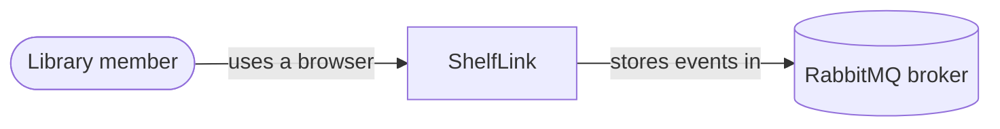
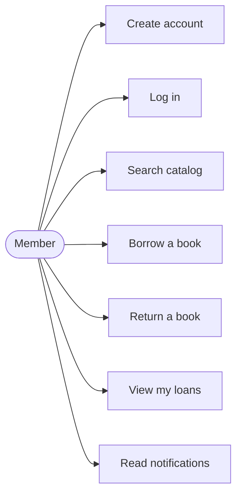

# 01 Overview

## What ShelfLink is

ShelfLink lets library members search a catalog, borrow and return books, and receive notifications about their loans, all from a web browser.

The domain is deliberately small. The point of the project is the architecture: independent services that own their own data and cooperate over HTTP and messaging.

## Course requirements and how they are met

| Requirement | How ShelfLink meets it |
|---|---|
| 3 to 4 microservices plus a client | Four services (auth, catalog, loans, notifications) plus an API gateway and a web client |
| Any programming language | Node.js with Express, one process per service |
| Browser based | Single-page web client served by the `web` service |
| Documentation in `docs/` | This folder |
| Diagrams in Mermaid | Every diagram in this repository is a Mermaid block |

## Services

| Service | Responsibility | Owns | Port |
|---|---|---|---|
| auth-service | Register users, log in, issue JWTs | users | 3001 |
| catalog-service | Books and how many copies are free | books | 3002 |
| loans-service | Borrow and return, loan history, announces events | loans | 3003 |
| notification-service | Turns events into user notifications | notifications | 3004 |
| api-gateway | Single entry point that routes to services | nothing | 3000 |
| web | Serves the browser UI, proxies `/api` to the gateway | nothing | 8080 |

Each service splits along a business capability: identity, inventory, lending and communication. Each has one reason to change.

## System context

## Use cases

## Technology

| Concern | Choice | Why |
|---|---|---|
| Runtime | Node.js 20 | One language across every service and the browser |
| HTTP framework | Express | Minimal and well known |
| Storage | SQLite, one file per service | Zero setup, makes "database per service" literal |
| Messaging | RabbitMQ (fanout exchange) | Decouples loans from notifications |
| Authentication | JWT signed with a shared secret | Stateless, verified locally by each service |
| Packaging | Docker Compose | One command starts everything |
| Browser client | Plain HTML, CSS and JavaScript | No build step to explain or break |
