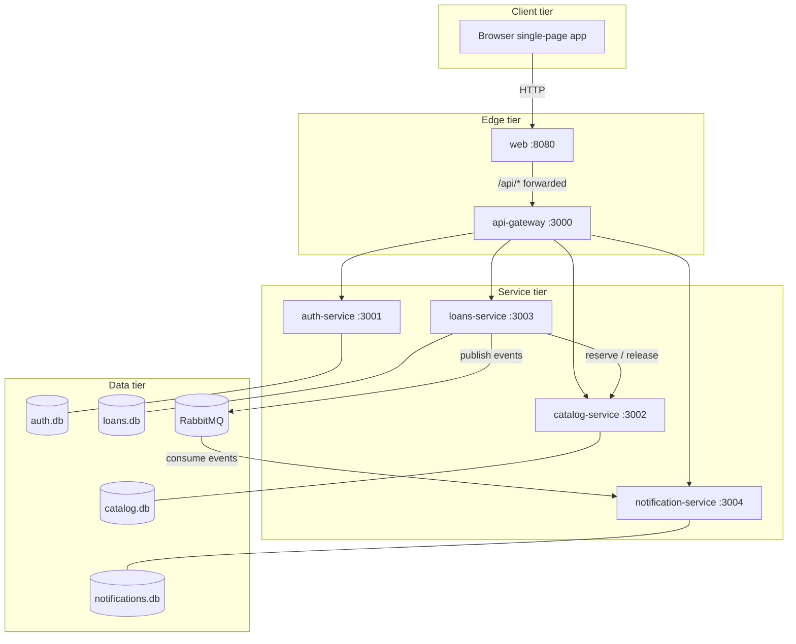
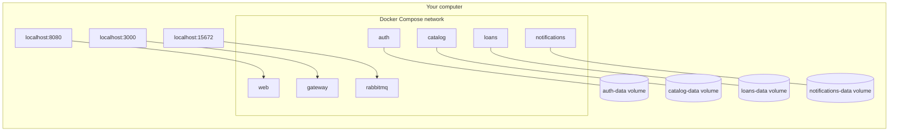
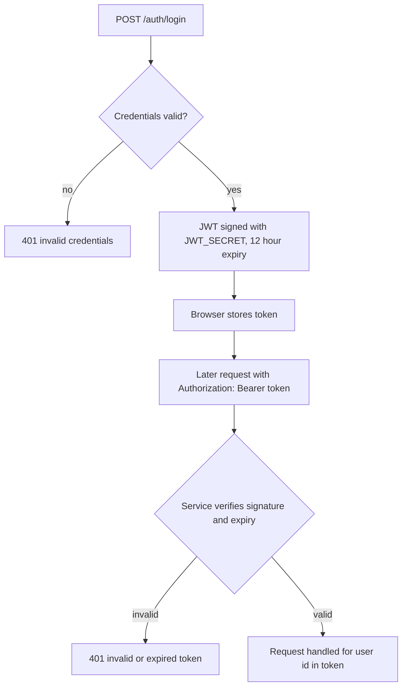
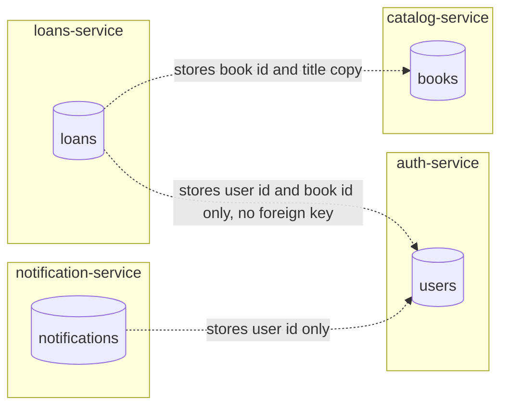

# 02 Architecture

## Component view

The browser only ever talks to the `web` service. The `web` service forwards API calls to the gateway, and the gateway is the only component that knows where the backend services live.

## Deployment view

Everything runs as containers on one Docker Compose network. Containers reach each other by service name through Docker's built-in DNS, so `http://catalog:3002` just works.

Only three ports are published to the host. The four backend services are reachable only from inside the network.

## Responsibilities by layer

| Layer | Does | Deliberately does not |
|---|---|---|
| web | Serves static files, forwards `/api` | Contain business logic |
| gateway | Routes by URL prefix | Authenticate or transform requests |
| services | Own business rules and data | Read each other's databases |
| RabbitMQ | Holds events until consumed | Know anything about the business |

## Authentication flow

Auth-service issues a JWT. Loans and notifications verify it themselves with the shared secret, so no service calls auth-service on every request.

## Data ownership

Each service has a private database. Other services learn about its data only through its API or through events, never through a shared table.

