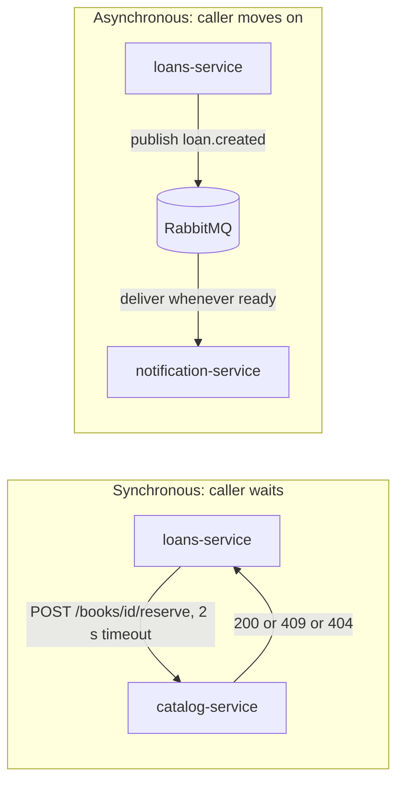
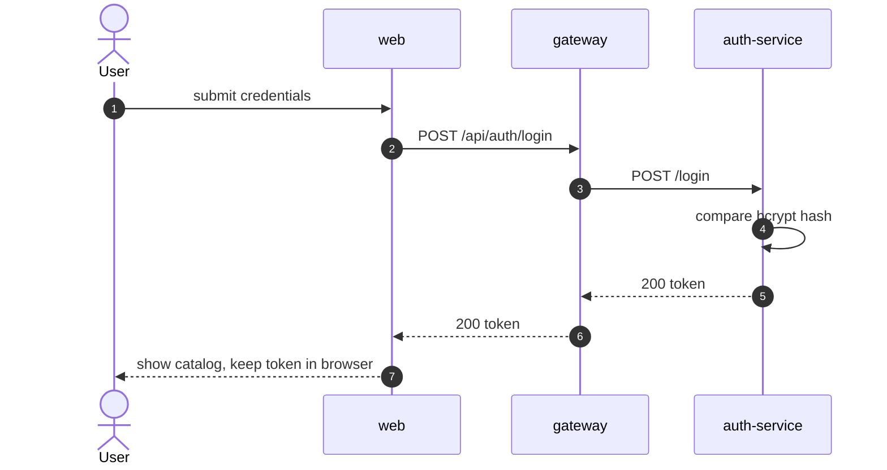
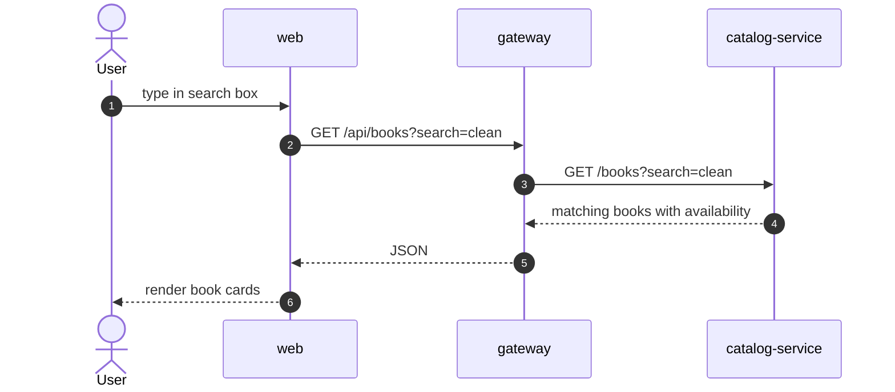
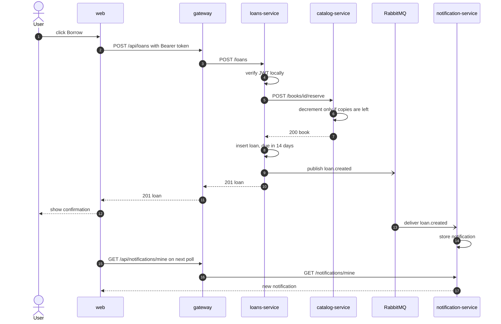
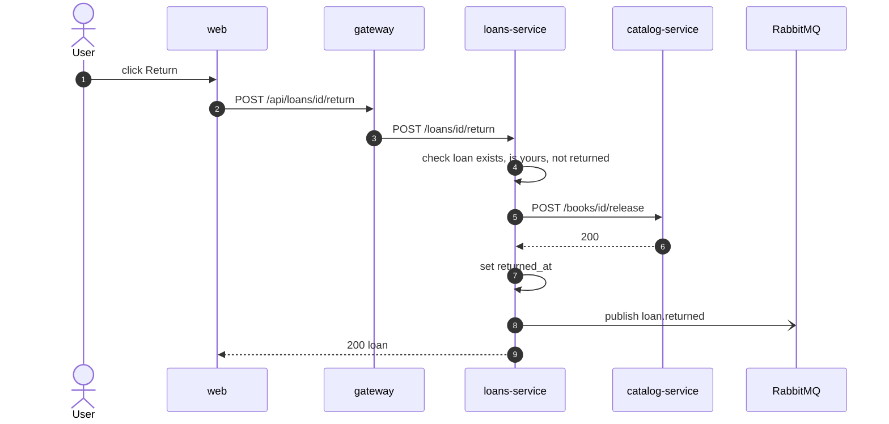
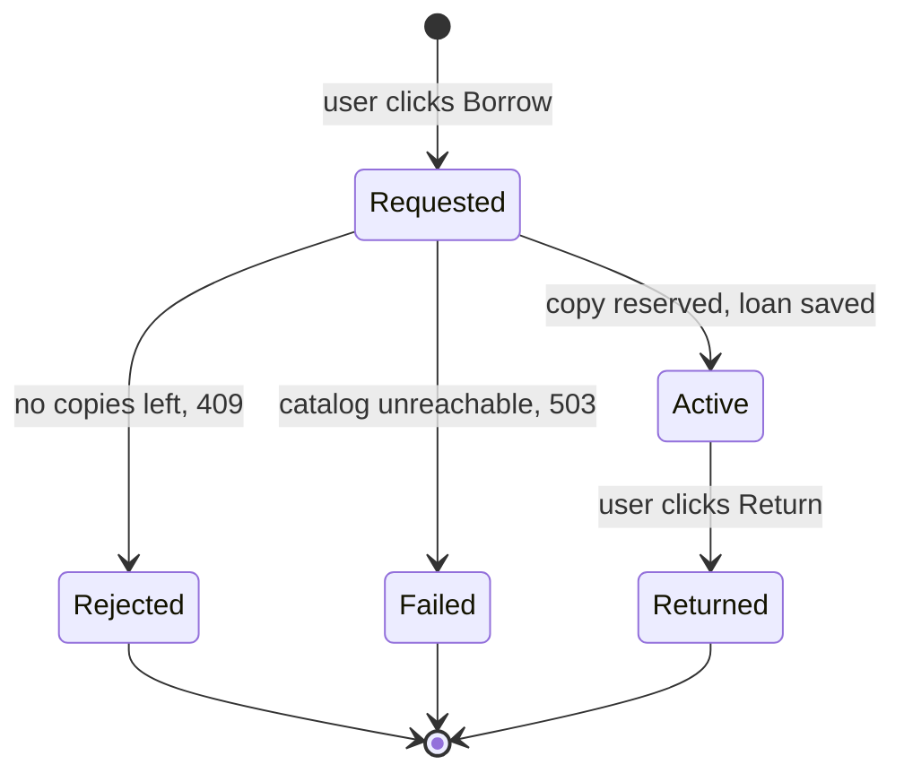
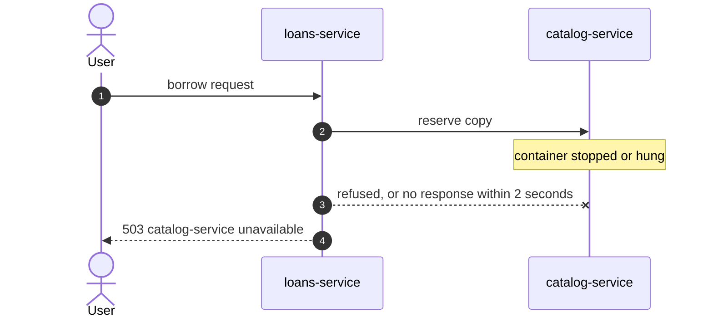
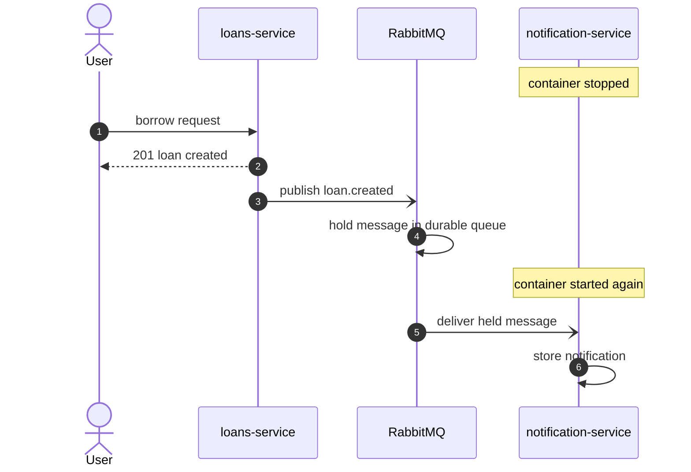
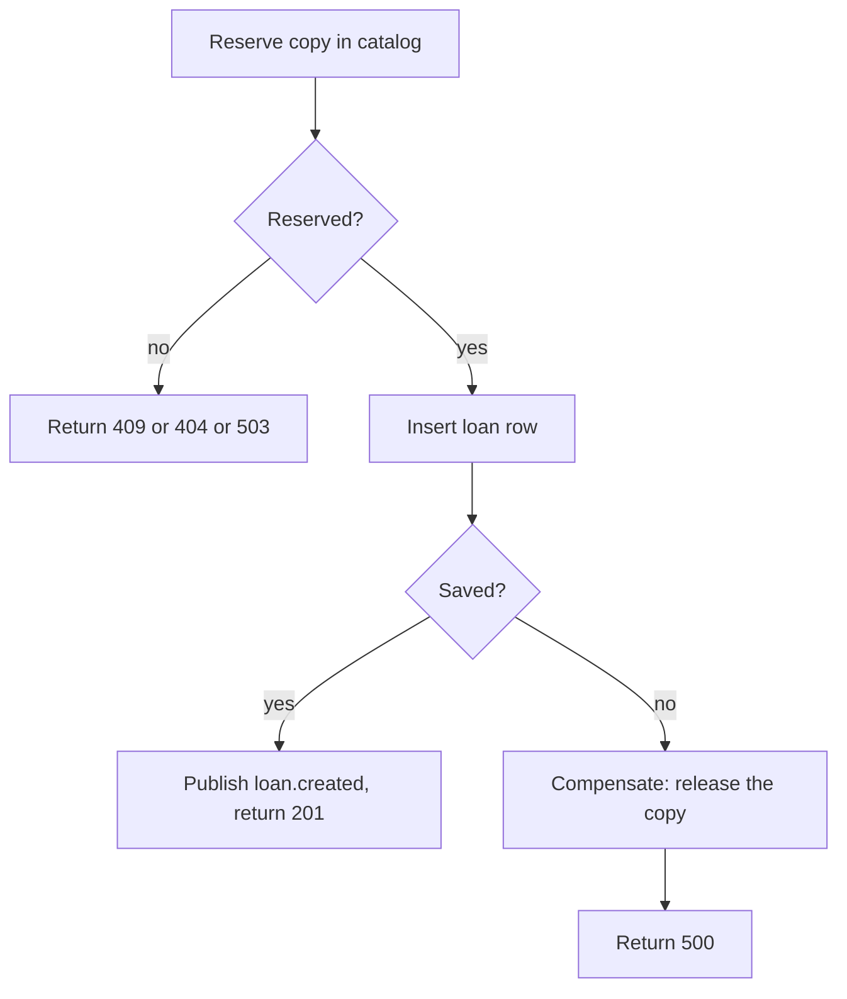
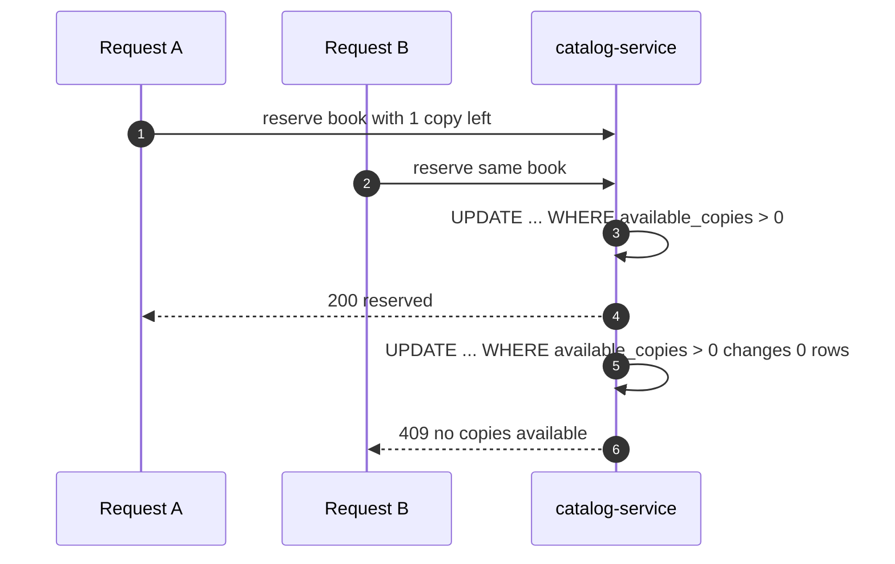

# 03 Communication

ShelfLink uses two styles of communication on purpose.

| Style | Used for | Why |
|---|---|---|
| Synchronous HTTP | loans-service asking catalog-service to reserve a copy | The caller needs the answer before it can continue |
| Asynchronous events | loans-service announcing a loan to notification-service | The caller must not wait for, or depend on, the consumer |

## Register and log in

## Search the catalog

## Borrow a book

This is the main flow. It combines a synchronous call, a local write and an asynchronous event.

Steps 12 onward happen after the user already has their answer.

## Return a book

## Loan lifecycle

## Failure behaviour

### Catalog is down

Loans-service never hangs waiting for catalog. A stopped container refuses the connection, so the answer is an immediate `503`. A catalog that is running but unresponsive makes loans-service give up after 2 seconds and answer `503`. In both cases no loan is saved.

A timeout means the outcome is unknown, not that the request failed. If a slow catalog finishes the reservation after loans-service has given up, one copy stays reserved with no loan attached. This was observed while testing with a deliberately frozen catalog process. Closing the gap properly needs idempotent reservation ids, which is listed under [known limitations](07-design-decisions.md#known-limitations).

### Notifications is down

The borrow succeeds, because loans-service never calls notification-service. The event waits in a durable queue and is delivered when the consumer comes back.

### Loan could not be saved after reserving

If the reservation succeeds but saving the loan fails, loans-service releases the copy again, so no copy is leaked.

### Two users take the last copy

Catalog does the check and the decrement in a single SQL statement, so only one request can win.

## Events

| Event | Published by | Payload | Consumed by |
|---|---|---|---|
| `loan.created` | loans-service | loanId, userId, username, bookId, bookTitle, dueAt | notification-service |
| `loan.returned` | loans-service | loanId, userId, username, bookId, bookTitle | notification-service |

Events travel through a fanout exchange named `library_events`. Notification-service binds a durable queue named `notifications_queue`. A second consumer, for example an email service, could bind its own queue without any change to loans-service.
