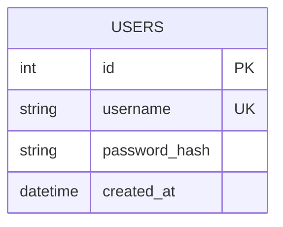
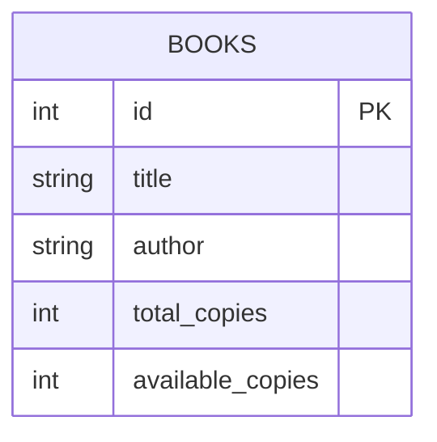
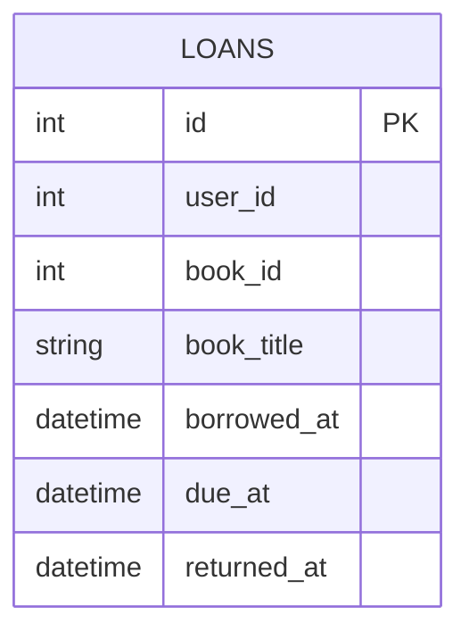
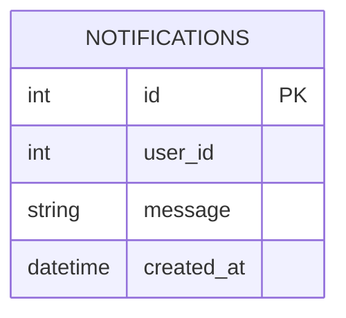
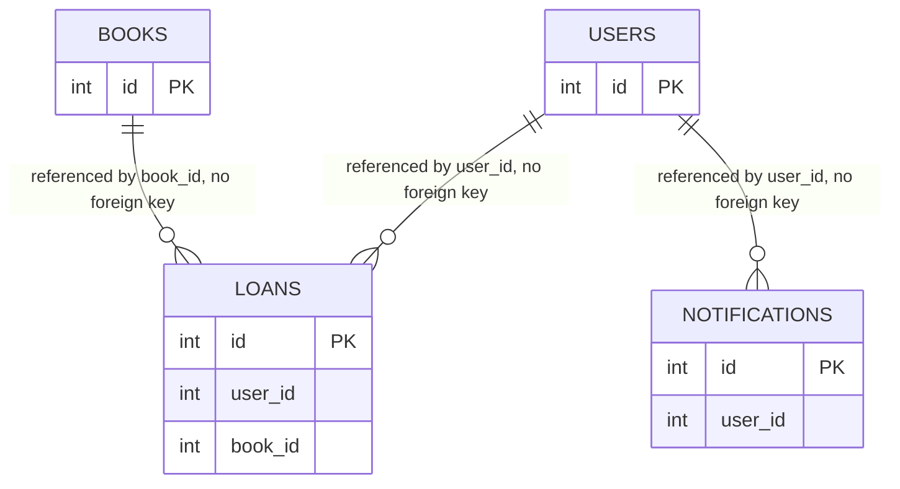

# 04 Data model

Each service owns one SQLite database file, kept in its own Docker volume. There are no foreign keys between databases. Where one service refers to another service's data, it stores a plain id, and the meaning of that id is only enforced by the API.

## auth-service

Passwords are stored as bcrypt hashes, never in plain text.

## catalog-service

`available_copies` is the single source of truth for availability. It is changed only by the reserve and release endpoints.

## loans-service

`user_id` and `book_id` are references to other services' data. `book_title` is a deliberate copy taken at borrow time so the loan list can be shown without calling catalog-service for every row.

## notification-service

## How the services refer to each other

This diagram is logical only. In reality USERS, BOOKS, LOANS and NOTIFICATIONS live in four separate databases, so no join between them is ever possible. Combining their data is the job of the calling service or the browser.

## Seed data

Catalog-service inserts four books the first time it starts with an empty database.

| Title | Author | Copies |
|---|---|---|
| Clean Code | Robert C. Martin | 2 |
| Designing Data-Intensive Applications | Martin Kleppmann | 1 |
| Building Microservices | Sam Newman | 3 |
| The Pragmatic Programmer | David Thomas and Andrew Hunt | 2 |
