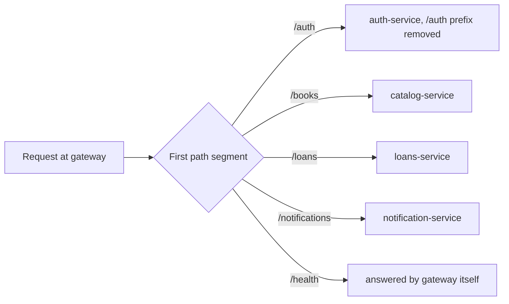

# 05 API reference

The browser calls everything under `/api` on the web service (port 8080). The web service strips `/api` and forwards to the gateway, which routes by the first path segment. The paths below are the ones the gateway receives.

## Gateway routing



Note that `/auth/login` reaches auth-service as `/login`, while the other prefixes are passed through unchanged.

## Authentication

Endpoints marked **JWT** require the header `Authorization: Bearer <token>`. A missing, invalid or expired token returns `401`.

## Auth

| Method | Path | Auth | Body | Success | Errors |
|---|---|---|---|---|---|
| POST | `/auth/register` | none | `username`, `password` | `201` id, username | `400` missing fields, `409` username taken |
| POST | `/auth/login` | none | `username`, `password` | `200` token, username | `401` invalid credentials |
| POST | `/auth/verify` | none | `token` | `200` valid, payload | `401` invalid |

## Catalog

| Method | Path | Auth | Description | Success | Errors |
|---|---|---|---|---|---|
| GET | `/books` | none | List books, optional `?search=` over title and author | `200` array | none |
| GET | `/books/:id` | none | One book | `200` book | `404` |
| POST | `/books/:id/reserve` | internal | Take one copy, used by loans-service | `200` book | `404`, `409` no copies |
| POST | `/books/:id/release` | internal | Give one copy back, used by loans-service | `200` book | `404` |

The reserve and release endpoints are reachable through the gateway in this course project. A production system would restrict them to service-to-service calls.

## Loans

| Method | Path | Auth | Body | Success | Errors |
|---|---|---|---|---|---|
| POST | `/loans` | JWT | `bookId` | `201` loan | `400`, `404` book, `409` no copies, `503` catalog down |
| POST | `/loans/:id/return` | JWT | none | `200` loan | `403` not yours, `404`, `409` already returned |
| GET | `/loans/mine` | JWT | none | `200` array, newest first | `401` |

A loan looks like this:

```json
{
  "id": 1,
  "user_id": 1,
  "book_id": 1,
  "book_title": "Clean Code",
  "borrowed_at": "2026-10-14 09:00:00",
  "due_at": "2026-10-28T09:00:00.000Z",
  "returned_at": null
}
```

## Notifications

| Method | Path | Auth | Success |
|---|---|---|---|
| GET | `/notifications/mine` | JWT | `200` the newest 20 notifications for the caller |

## Health checks

Every service exposes `GET /health` returning `{ "status": "ok", "service": "<name>" }`. Through the gateway only the gateway's own `/health` is reachable. The web service has its own at port 8080.

## Trying the API with curl

```bash
curl -X POST http://localhost:3000/auth/register -H "Content-Type: application/json" -d '{"username":"alice","password":"secret123"}'
curl -X POST http://localhost:3000/auth/login    -H "Content-Type: application/json" -d '{"username":"alice","password":"secret123"}'
curl http://localhost:3000/books
```

On Windows PowerShell, `curl` is an alias of `Invoke-WebRequest`. Use `curl.exe` instead, or just use the web interface.
