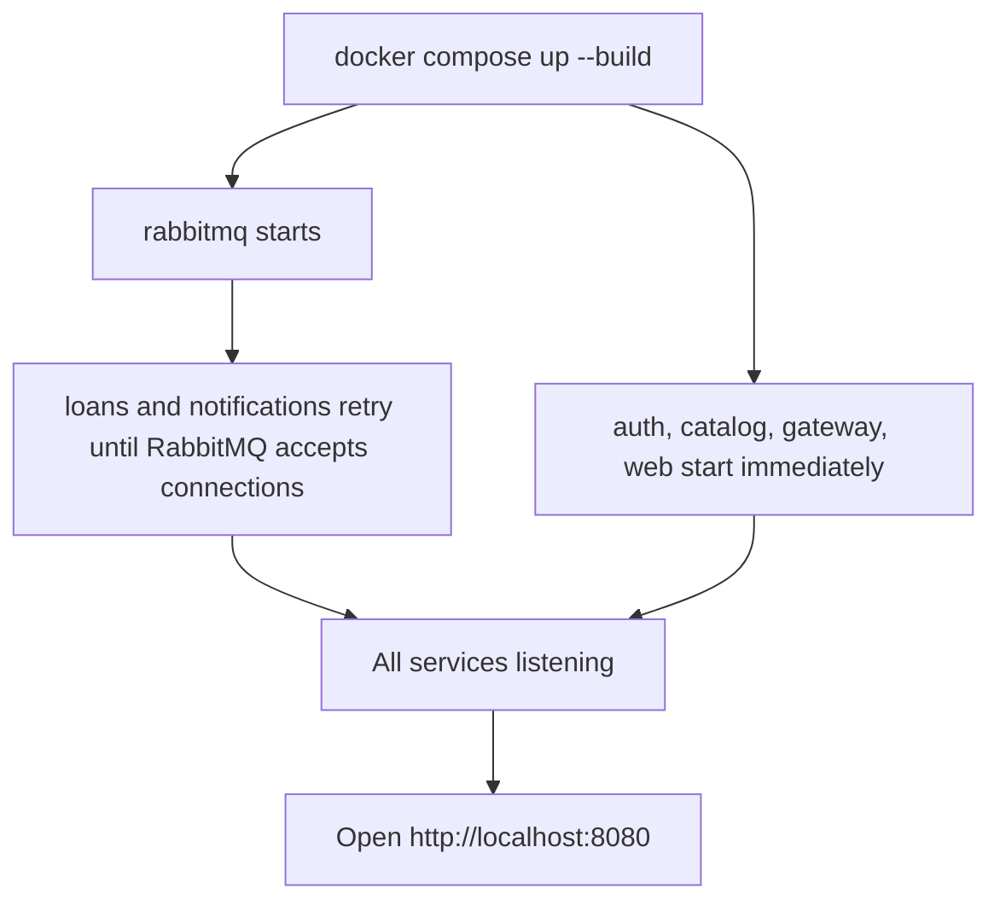
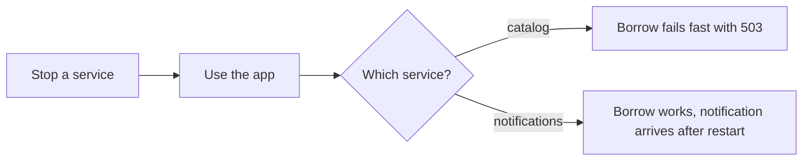

# 06 Running and testing

## Prerequisites

| Tool | Notes |
|---|---|
| Docker Desktop | Must be running (whale icon steady in the system tray) |
| A browser | Any modern one |

Node.js is only needed if you want to run a service outside Docker.

## Start

From the folder that directly contains `docker-compose.yml`:

```bash
docker compose up --build
```

The first build takes a few minutes. The system is ready when the log shows `listening` lines for auth, catalog, loans, notifications, the gateway and web, plus `connected to RabbitMQ` and `consuming events`.



Loans and notifications retry their RabbitMQ connection every 3 seconds for up to 10 attempts, so it is normal to see a few "RabbitMQ not ready" lines at startup.

## Stop

Press `Ctrl+C` in the compose window, then:

```bash
docker compose down        # keep data
docker compose down -v     # also delete all databases
```

## Demo script

| Step | Do this | You should see |
|---|---|---|
| 1 | Open http://localhost:8080 and create an account | The catalog with four books |
| 2 | Click Borrow on Clean Code | A toast, the book in My loans, availability drops from 2 to 1 |
| 3 | Watch the Notifications panel | A "You borrowed Clean Code" message within about 3 seconds |
| 4 | Look at the Request trace panel | Each call listed with method, path, status and time |
| 5 | Click Return | Availability back to 2, a "Thanks for returning" notification |
| 6 | Open http://localhost:15672 (guest / guest) | RabbitMQ queues and message rates |

### Failure demos

Run these in a second terminal from the project root.

**Catalog down:**

```bash
docker compose stop catalog
```

Click Borrow in the browser. The request fails straight away with a clear "catalog-service unavailable" message instead of hanging. Restore with `docker compose start catalog`. (If catalog were running but frozen, the same message would appear after the 2 second timeout.)

**Notifications down:**

```bash
docker compose stop notifications
```

Borrow a book. It succeeds. Then run `docker compose start notifications` and the notification appears a few seconds later, because RabbitMQ held the event.



## Quick checks

| Check | Expected |
|---|---|
| http://localhost:3000/health | `{"status":"ok","service":"api-gateway"}` |
| http://localhost:8080/health | `{"status":"ok","service":"web-client"}` |
| http://localhost:8080/api/books | JSON array of four books |

## Troubleshooting

| Symptom | Likely cause | Fix |
|---|---|---|
| `docker` is not recognized | Terminal opened before Docker was installed | Open a new terminal, or restart the PC |
| Cannot connect to the Docker daemon | Docker Desktop not running | Start it and wait for the whale icon to settle |
| `no configuration file provided` | Wrong folder | `cd` into the folder that contains `docker-compose.yml` |
| Port already in use | Another program on 8080, 3000 or 15672 | Stop it, or change the left side of the port mapping in `docker-compose.yml` |
| Page loads but lists nothing, console shows 404 | Old image cached | `docker compose up --build` again |
| Borrow returns 503 | Catalog container not running | `docker compose start catalog` |
| Notifications never appear | Notification-service could not reach RabbitMQ | Check its logs for "consuming events" |
| Changed code has no effect | Docker reused a cached layer | `docker compose build --no-cache <service>` |

Read one service's logs with `docker compose logs -f loans`.

## Running a service without Docker

Useful while developing. Example for catalog:

```bash
cd services/catalog
npm install
node src/index.js
```

Loans and notifications also need a reachable RabbitMQ, for example `docker compose up rabbitmq`, and `RABBITMQ_URL=amqp://localhost`.
