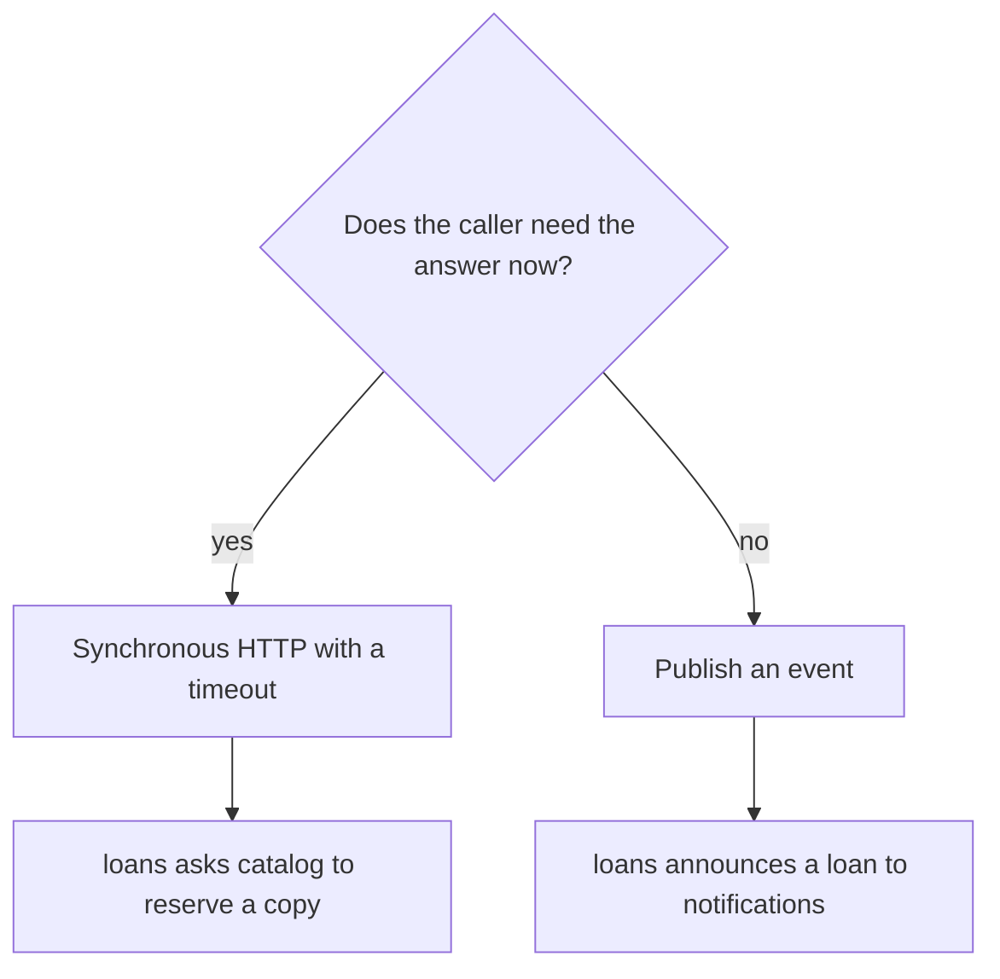

# 07 Design decisions

This document explains why ShelfLink is built the way it is, what it deliberately leaves out, and how to answer the questions a reviewer is likely to ask.

## Decisions at a glance



| Decision | Chosen | Alternative | Reason |
|---|---|---|---|
| Split by | Business capability | Technical layer | Each service has one reason to change |
| Data | Database per service | Shared database | A shared database makes a distributed monolith |
| Client entry | API gateway | Client calls services directly | Client does not need to know service addresses |
| Token check | Local JWT verification | Call auth-service each time | Fewer network hops and no runtime dependency on auth |
| Loan to catalog | Sync HTTP, 2 s timeout | Event | The answer decides whether the loan exists |
| Loan to notification | Async event | Sync HTTP | A notification must never block or fail a borrow |
| Last-copy race | Single atomic SQL update in catalog | Distributed lock | Simple and correct for one authoritative owner |
| Browser to backend | Same-origin `/api` proxy | CORS between origins | No CORS setup and the gateway address stays hidden |
| Notification delivery | Polling every 3 s | WebSocket | Far less code, adequate for a demo |

## Concurrency: the last copy

Two members clicking Borrow on the last copy at the same moment is the classic distributed-systems problem in this project.

Catalog-service owns availability and performs the check and the decrement as one statement:

```sql
UPDATE books SET available_copies = available_copies - 1
WHERE id = ? AND available_copies > 0
```

If it changed one row the caller won. If it changed zero rows the caller gets `409`. There is no window between the check and the write, so both cannot win.

What is not atomic is the pair of steps "reserve in catalog, then save in loans". If the second fails, loans-service compensates by releasing the copy. This is a small hand-written saga, and it is the honest answer to "do you have distributed transactions?": no, there are compensating actions.

## Known limitations

| Limitation | Impact | What production would do |
|---|---|---|
| Shared `JWT_SECRET` in compose file | Anyone with the file can mint tokens | Secret manager, or asymmetric keys so verifiers hold only a public key |
| Token kept in `localStorage` | Readable by any script injected into the page | HTTP-only cookies |
| No HTTPS | Traffic is readable on the network | TLS at the edge |
| Reserve and release are reachable through the gateway | A client could call them directly | Internal-only network or service credentials |
| A timed-out reserve call may still complete later | A copy can stay reserved with no loan, so availability drifts down | Idempotent reservation ids, or reservations that expire unless confirmed |
| Event published after the database write, without an outbox | A crash between the two loses the event | Transactional outbox |
| Exchange and messages are not persistent | Events survive a consumer outage but not a broker restart | Durable exchange and persistent messages |
| Return releases a copy even if catalog is down | Availability count can drift | Retry queue for failed releases |
| SQLite files | One writer, no replication | PostgreSQL per service |
| No rate limiting or password rules | Brute force possible | Rate limiter, lockout, password policy |
| No automated tests | Regressions are caught by hand | Unit and contract tests, CI pipeline |

Naming these limits yourself is stronger in a review than hoping nobody asks.

## Likely questions

**Why microservices for something this small?**
A monolith would be simpler and would be the right call for a real library. The project exists to demonstrate the pattern: service boundaries, data ownership, synchronous and asynchronous communication, and failure handling.

**What happens if catalog-service is down when someone borrows?**
Loans-service returns `503` straight away if the connection is refused, or after a 2 second timeout if catalog is hung. No loan is saved. One honest caveat: a timeout means "unknown", so a slow catalog could still complete the reservation later and leave a copy reserved. See [failure behaviour](03-communication.md#failure-behaviour).

**What happens if notification-service is down?**
The borrow is unaffected. The event waits in a durable queue and is delivered when the service restarts.

**Why no shared database?**
A shared database couples every service to one schema. A change by one team could break all the others, and services could no longer be deployed independently.

**How do services find each other?**
Docker Compose DNS: the service name in `docker-compose.yml` resolves to the container. In production this would be a service registry or Kubernetes DNS.

**Why a gateway?**
The browser needs one address. Services can move, split or be replaced without any client change.

**Why does the loan store a copy of the book title?**
So the loan list renders without one catalog call per row. It is a deliberate trade of a little duplicated data for independence from catalog-service at read time.

**How would you add an email service?**
Create a new service, bind its own queue to the `library_events` exchange, and handle `loan.created`. Loans-service needs no change.

**How would you scale this?**
Run several instances of a stateless service behind a load balancer. The databases would first move from SQLite to a server database, since several instances cannot share one SQLite file safely.

**What would you test?**
Contract tests for each API, an integration test of the borrow flow with a real RabbitMQ, and a concurrency test that fires many parallel borrows at a one-copy book and expects exactly one success.
