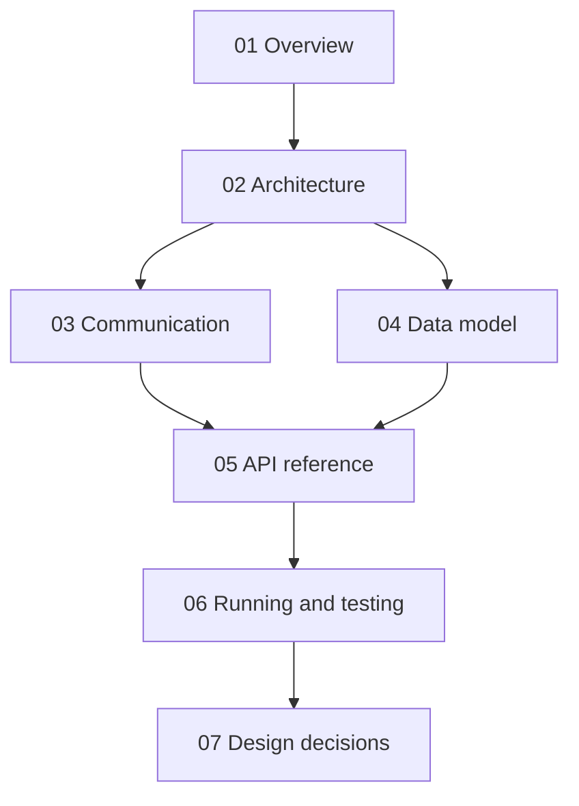

# ShelfLink documentation

Start with the overview, then read in order, or jump to what you need.

| # | Document | Read it when you want to know |
|---|---|---|
| 01 | [Overview](01-overview.md) | What the system does and which services exist |
| 02 | [Architecture](02-architecture.md) | How the pieces are wired and deployed |
| 03 | [Communication](03-communication.md) | Exactly what happens on each user action |
| 04 | [Data model](04-data-model.md) | Which service owns which data |
| 05 | [API reference](05-api-reference.md) | Endpoint details |
| 06 | [Running and testing](06-running-and-testing.md) | How to run it and demo it |
| 07 | [Design decisions](07-design-decisions.md) | Why it is built this way, and its limits |
